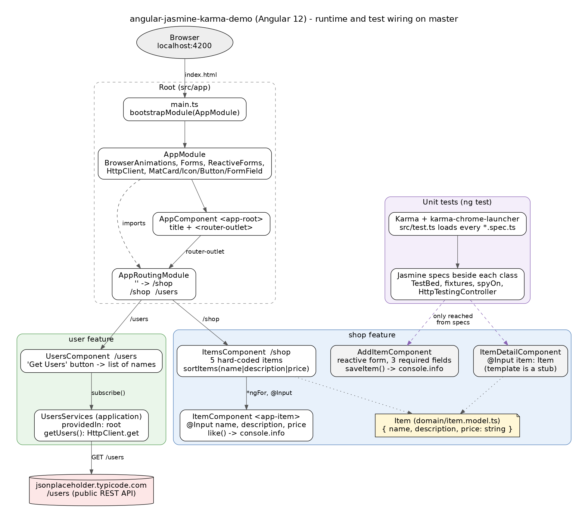

# Architecture

This page describes what the code on `master` does today. The diagram source is
[`diagrams/architecture.dot`](diagrams/architecture.dot) (Graphviz); run
[`diagrams/render.sh`](diagrams/render.sh) after editing it to regenerate the PNG and SVG.

## What the app is

A small Angular 12 single-page app whose real purpose is to host example Jasmine/Karma unit
tests. It has one root module, two routed screens and no backend of its own. The only network
call goes to the public `jsonplaceholder.typicode.com` API.

## Layout

Each feature folder follows a domain / application / infrastructure split:

| Path | Layer | Contents |
| --- | --- | --- |
| `src/main.ts`, `src/index.html` | bootstrap | `platformBrowserDynamic().bootstrapModule(AppModule)`; `<app-root>` host page |
| `src/app/app.module.ts` | root | Declares every component; imports `BrowserAnimationsModule`, `FormsModule`, `ReactiveFormsModule`, `HttpClientModule`, Angular Material card/icon/button/form-field |
| `src/app/app-routing.module.ts` | root | `/shop` → `ItemsComponent`, `/users` → `UsersComponent`, empty path redirects to `/shop` |
| `src/app/app.component.*` | root | Prints the app title and hosts `<router-outlet>` |
| `src/app/shop/domain/item.model.ts` | domain | `Item` interface: `name`, `description`, `price` (all strings) |
| `src/app/shop/infrastructure/ng-components/` | infrastructure | `items`, `item`, `add-item`, `item-detail` components |
| `src/app/user/application/UsersServices.ts` | application | `UsersServices` (`providedIn: 'root'`), `getUsers()` = `HttpClient.get` on `https://jsonplaceholder.typicode.com/users` |
| `src/app/user/infrastructure/ng-components/users/` | infrastructure | `UsersComponent` |
| `src/test.ts`, `karma.conf.js` | tests | Karma entry point that loads every `*.spec.ts` under `src/` |

The shop feature has no `application` layer: its data is hard-coded in the component.

## Runtime flow

- **Shop (`/shop`, default route).** `ItemsComponent` holds five hard-coded `Item`s and renders one
  `ItemComponent` (`<app-item>`) per item through `*ngFor`, passing `name`, `description` and
  `price` as `@Input`s. Three buttons call `sortItems(field)`, which sorts the array in place by
  that field and toggles ascending/descending when the same field is clicked again. Prices are
  strings, so they sort with `localeCompare` (for example `"123"` before `"59"`).
  `ItemComponent.like()` only writes to `console.info`.
- **Users (`/users`).** `UsersComponent` gets `UsersServices` injected. Clicking **Get Users** calls
  `getUsers()`, subscribes, and stores the response in `users`; the template lists each user's
  `name`. There is no error handling or loading state.
- **Not reachable from the UI.** `AddItemComponent` (a reactive form with three required fields;
  `saveItem()` only logs) and `ItemDetailComponent` (`@Input() item: Item`, stub template) are
  declared in `AppModule` but no route or template uses them. They exist for their specs.

## Tests

Every class has a `*.spec.ts` beside it, and the specs are the main content of the repo
(see the README for the testing concepts they illustrate):

| Spec | Shows |
| --- | --- |
| `app.component.spec.ts` | Component creation with `RouterTestingModule` |
| `item.component.spec.ts` | Basic creation, `@Input` rendering, `spyOn` on `like()` (commented in Spanish) |
| `add-item.component.spec.ts` | Reactive-form validation with the AAA pattern |
| `item-detail.component.spec.ts` | Passing data from parent to child through `@Input` |
| `items.component.spec.ts` | Rendering the list and the sort behaviour |
| `users.component.spec.ts` | Stubbing a service call from a component with `spyOn(...).and.returnValue(of(...))` |
| `UsersServices.service.spec.ts` | HTTP service tests with `HttpClientTestingModule` and `HttpTestingController` |

`ng test` runs them in Chrome through Karma. Coverage is off by default (`karma.conf.js` reporters are
`progress` and `kjhtml`); `ng test --code-coverage` writes it to `coverage/angular-jasmine-karma-demo`.

## Known state of `master`

`ng build` and `ng test` currently fail to compile: `items.component.ts` imports
`../../domain/item.model` and `users.component.ts` imports `../../application/UsersServices`,
one directory level short of the real files (`../../../domain/...`, `../../../application/...`).
The test build also hits strict-mode TypeScript errors in `UsersServices.service.spec.ts`,
`users.component.spec.ts` and `item-detail.component.spec.ts`. The behaviour above is what the source describes once those
imports resolve.
