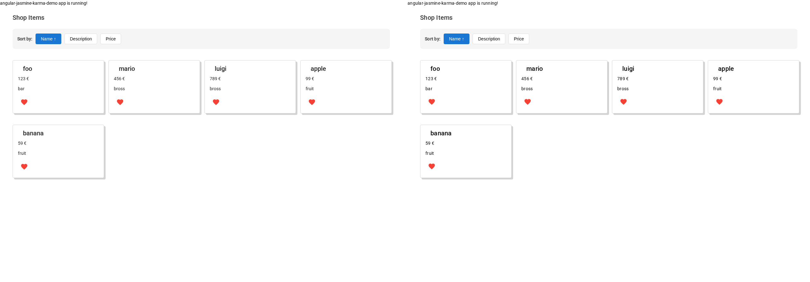
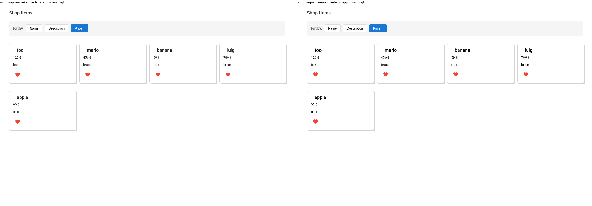

# Parity report: Angular 12 baseline vs Angular 21 upgrade

Same Playwright specs, two projects: `baseline` (Angular 12, http://localhost:4000) and `upgraded` (Angular 21, http://localhost:4200).
Retries: 2 (the /users page calls the shared public API jsonplaceholder.typicode.com).

Result: baseline 12/12 pass, upgraded 12/12 pass.

## Flows

| Page / flow | Baseline | Upgraded |
|---|---|---|
| shell.spec.ts › app shell and routing › root redirects to /shop | pass | pass |
| shell.spec.ts › app shell and routing › document title and fonts are the same | pass | pass |
| shell.spec.ts › app shell and routing › unknown route keeps the shell and renders no page | pass | pass |
| shell.spec.ts › app shell and routing › navigating between /shop and /users with history | pass | pass |
| shop.spec.ts › shop items › lists the five items in their initial order | pass | pass |
| shop.spec.ts › shop items › sort by name toggles to descending, then ascending | pass | pass |
| shop.spec.ts › shop items › sort by price compares prices as text | pass | pass |
| shop.spec.ts › shop items › sort by description | pass | pass |
| shop.spec.ts › shop items › like button logs the item name | pass | pass |
| users.spec.ts › users › starts empty, then loads users from the API | pass | pass |
| users.spec.ts › users › renders whatever the API returns (stubbed, run-unique data) | pass | pass |
| users.spec.ts › users › API failure leaves the list empty and the page usable | pass | pass |

## Screenshots (baseline left, upgraded right)

| Page | Pixel diff | Size (baseline / upgraded) |
|---|---|---|
| [01-shop.png](side-by-side/01-shop.png) | 0.34% | 1280x900 / 1280x900 |
| [02-shop-sorted-by-price.png](side-by-side/02-shop-sorted-by-price.png) | 0.34% | 1280x900 / 1280x900 |
| [03-unknown-route.png](side-by-side/03-unknown-route.png) | 0.09% | 1280x900 / 1280x900 |
| [04-users-empty.png](side-by-side/04-users-empty.png) | 0.12% | 1280x900 / 1280x900 |
| [05-users-loaded.png](side-by-side/05-users-loaded.png) | 0.47% | 1280x900 / 1280x900 |

### 01-shop.png



### 02-shop-sorted-by-price.png



### 03-unknown-route.png


### 04-users-empty.png


### 05-users-loaded.png


## Run it

```bash
# baseline (Angular 12, master + baseline build fixes) on :4000
git worktree add ../baseline 21b78bc && cd ../baseline
nvm use 20 && npm ci && NODE_OPTIONS=--openssl-legacy-provider npx ng serve --port 4000

# upgraded (Angular 21) on :4200 from this branch
nvm use 22 && npm ci && npx ng serve --port 4200

# parity suite
cd parity && npm ci && npx playwright install chromium
npx playwright test; node compose.mjs
```
